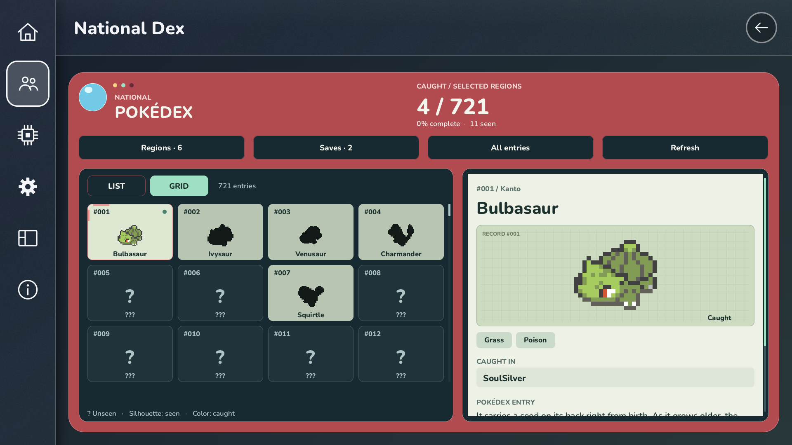
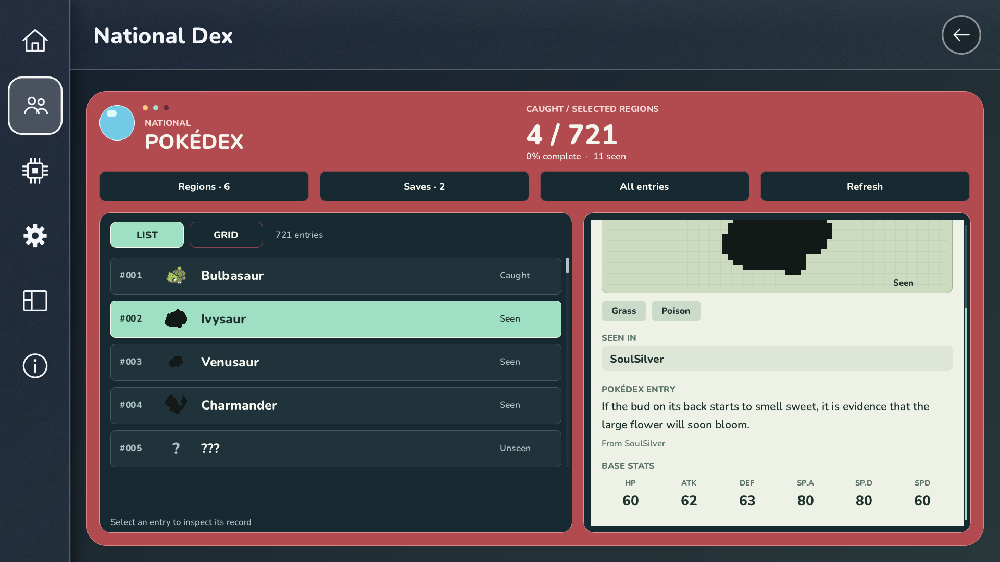
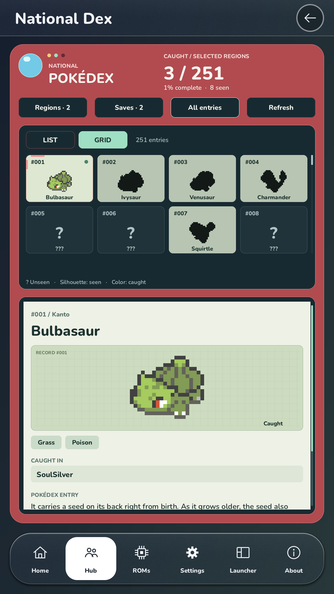
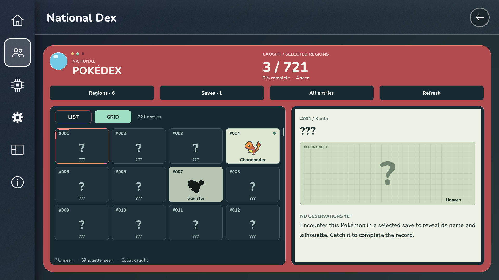

# National Dex Android validation — 13 November 2026

Built and installed the DS/GBA National Dex app on an Odin 3 running Android 15
(API 35), arm64-v8a, 4 KB memory pages, with an Adreno 830 GPU. The existing
`io.github.mamesj.pokemonds` installation was retained. The test app is
`io.github.coolman4128.fulldex.nationaldex`, labelled **Fulldex National Dex**.

## Build and fixes

Base revision: `156d478bb26735811f139b3ca0abec094eee5fdd`, plus the local fixes:

- `build_all.sh` now passes `-encoding UTF-8` to javac. Java packaging previously
  failed on the clean Linux environment's ASCII locale.
- First-time ROM folder selection no longer pins the empty fallback save
  directory merely because launcher caches created it. Existing ROM libraries,
  cartridge saves, save states and backups still preserve their save location.
  Before the fix, the test saves beside the selected ROMs appeared unavailable;
  after a fresh app setup with the fix, both were discovered.
- Opening a sidebar page now clears Home tab focus. A second guard gives page
  and sidebar actions precedence over stale tab focus. On the Odin, tapping
  National Dex after leaving an empty Home tab previously opened the Home
  tab's Move/Hide menu instead of the Dex.

Build environment: Ubuntu 24.04 in Docker Desktop, JDK 17, SDK platform 34,
build-tools 34.0.0, NDK 27.2.12479018, SDL 2.32.10, and the repository's pinned,
patched mGBA revision. The user supplied US SoulSilver (`IPGE`) for table
generation. No 3DS runtime kit was supplied or included.

APK signature verification and 16 KB ELF alignment checks passed. The device's
actual page size was 4 KB, so this is not a 16 KB runtime test.

## Checks

All five ROM-free National Dex CTest suites passed. The new
`test_android_save_folder.py` regression passed for fresh folders, cache-only
folders, existing libraries, saves, states, and nested backups.

On-device tests used real SoulSilver and Emerald ROMs with isolated synthetic
Pokédex saves. The existing Emerald save was entirely `0xFF` (uninitialized),
so it could not establish real player progress. Synthetic fixtures were never
used as gameplay saves or included in the APK.

| Check | Observed result |
| --- | --- |
| Cold launch and Android folder picker | Passed; native libraries loaded and both games discovered |
| Home tab focus regression | After updating the installed app, empty Home → Hub → National Dex opened save selection; Done opened the grid without the Home Move/Hide menu |
| Save selection and aggregation | Two saves produced 4 distinct caught and 11 seen; shared Pikachu counted once |
| Artwork and details | Caught sprites, seen silhouettes, hidden unseen identities, SoulSilver entry text and base stats displayed |
| List/Grid | Switching retained the selected species |
| Filters | 710 unseen, 7 seen-only and 4 caught; completion denominator stayed 721 |
| Regions | Kanto + Johto produced 3 / 251 caught and 8 seen |
| Touch scrolling | Entry and detail panels scrolled independently in landscape and portrait |
| Portrait | Android rotation forced to portrait with auto-rotate enabled; stacked layout filled the display |
| D-pad | Injected Android D-pad events moved grid selection correctly |
| Missing selected save | Refresh showed partial progress; restoring the file restored totals |
| Restart | Selected saves, regions and List view survived a cold restart |
| Background/resume | Returned to the Dex with its contents and scrolling intact |
| Save integrity | Both fixture hashes remained unchanged after Dex tests; original Emerald hash unchanged |
| DS smoke test | SoulSilver title screen rendered; pause and quit returned to the launcher |
| GBA smoke test | Emerald intro rendered |
| Shared main-app save | Both apps used `/sdcard/Roms/Fulldex/saves`; selecting the existing FireRed save showed 3 caught and 4 seen |

No crash was observed during these checks. Physical gamepad buttons, long
gameplay sessions, audio quality, cloud features and the external 3DS runtime
were not validated. The Odin controller was detected by SDL.

## Local artifacts and device handoff

- APK: `build-android-dist/fulldex-national-dex-arm64.apk`
- SHA-256: `13edf98e1e2dbaf9bd1705d2551a266c18675d22e37e941c6560cf563ca8e945`
- Source revision and patch: `build-android-dist/national-dex-source*`
- Screenshots, fixture copies and logs: `build-national-dex/device-test/`
- Docker image/container: `fulldex-android-build:local` / `fulldex-android-builder`
- Persistent Docker volumes: `fulldex-android-source`, `fulldex-android-home`
- Local build helpers and signing-key backup: ignored `android/` directory.

The new app remains installed and uses `/sdcard/Roms/Fulldex`. Its synthetic
selections were cleared, temporary device test files were removed, and the
original rotation settings were restored. Create an in-game save, then select
it in **Hub → National Dex → Saves** to include actual progress.

## Screenshots

Captured on the Odin 3. The first three images use isolated synthetic progress
with artwork and entry text decoded from the user's ROM. The last image shows
the existing FireRed save shared with the main app. No ROM or save files are
included in these documentation assets.

Grid, including caught, seen and unseen entries:

List with the detail panel scrolled to entry text and base stats:

Portrait layout with only Kanto and Johto selected:

Real FireRed progress from the main app's save folder:

